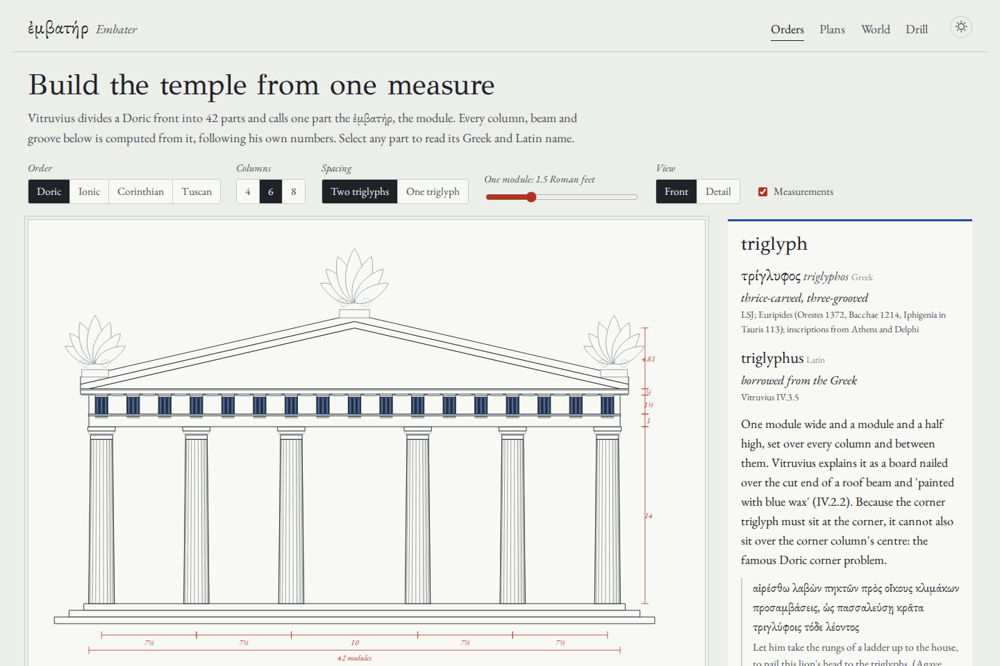
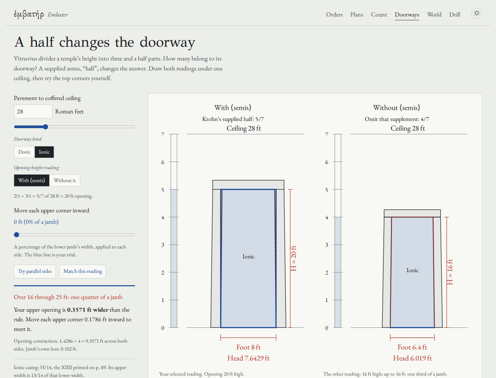
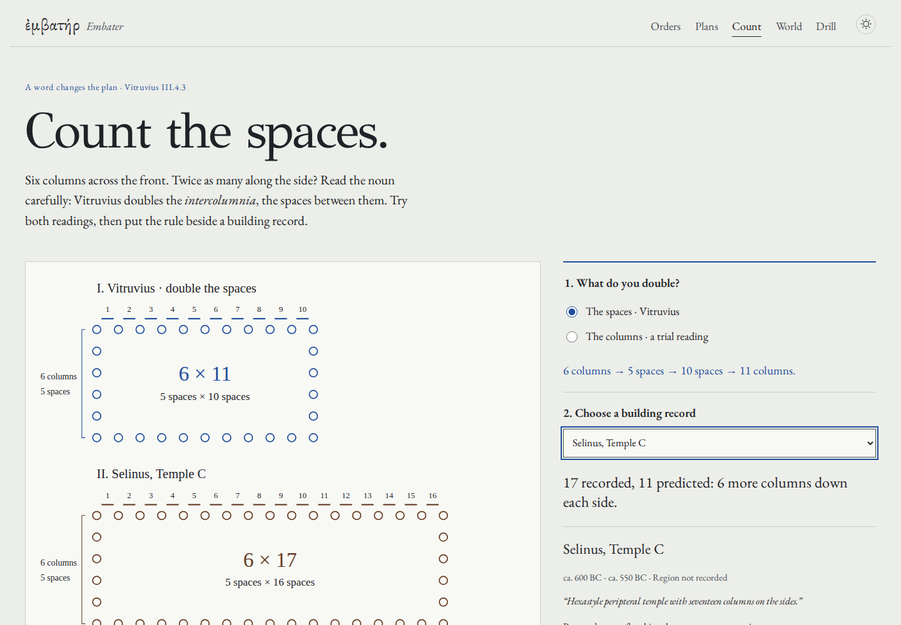
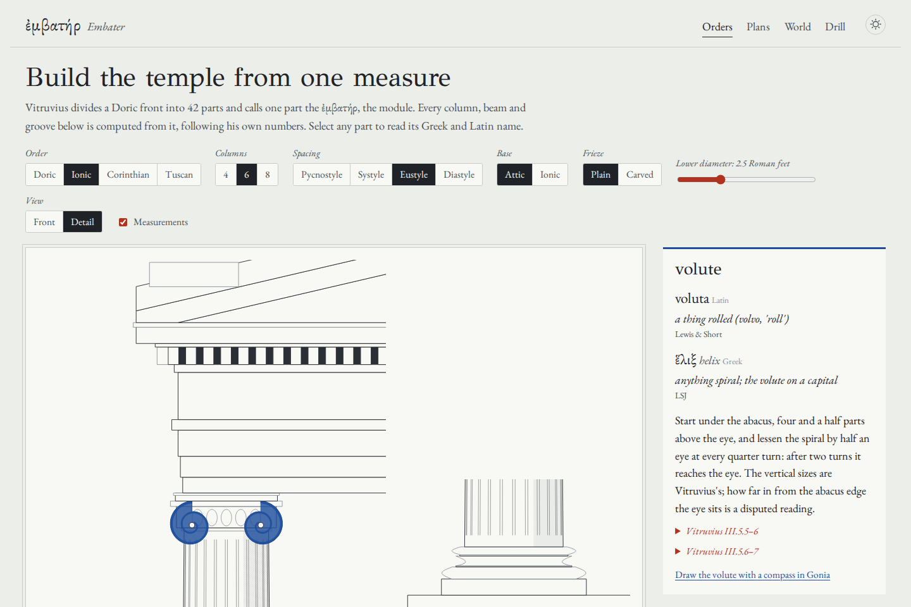
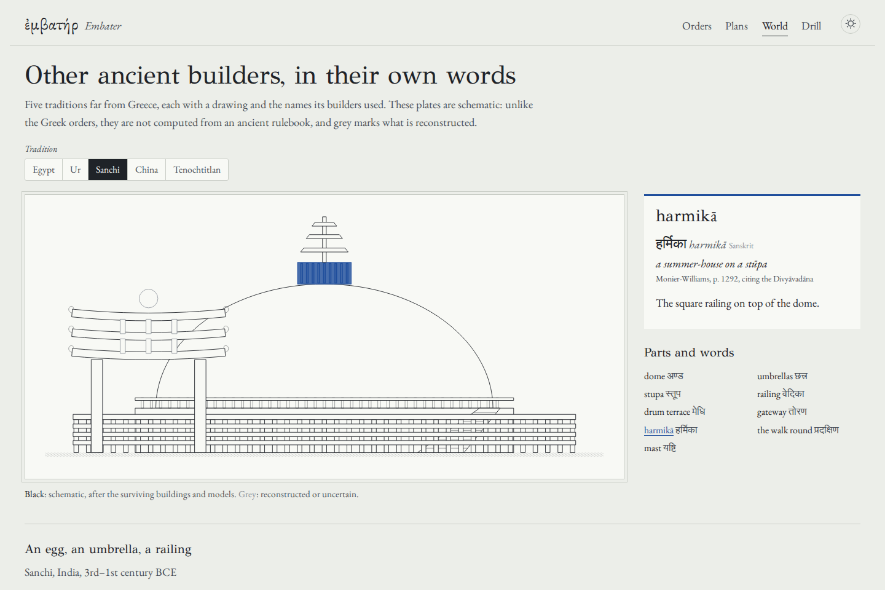
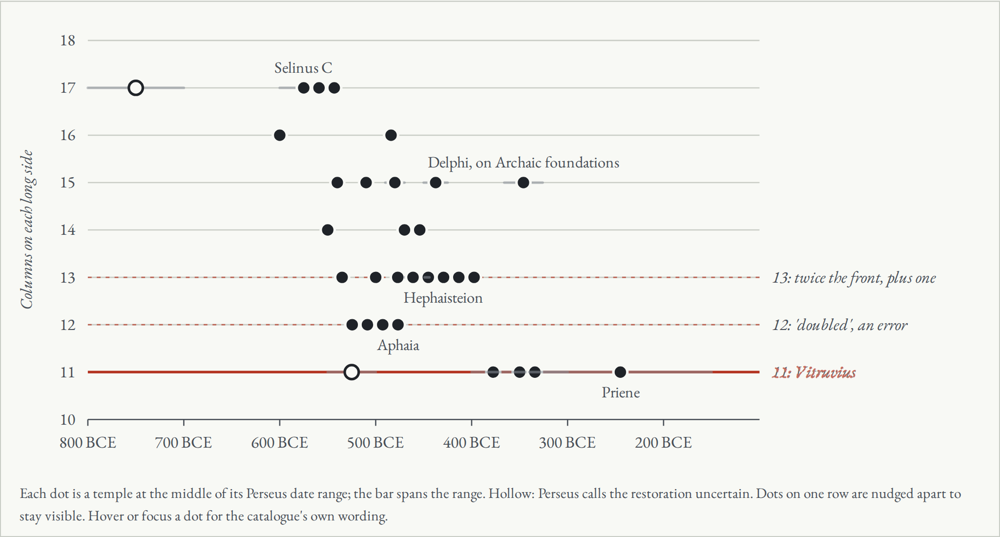
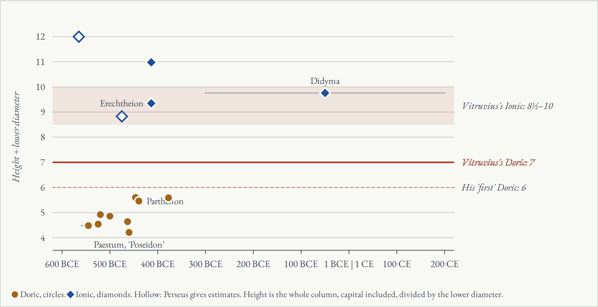
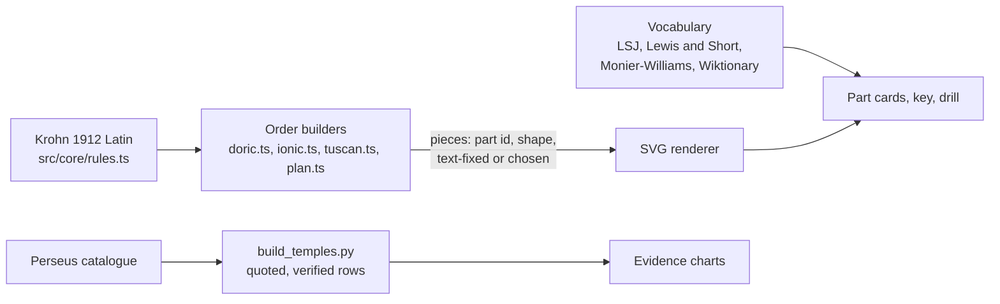

# Embater

**Draw Greek temples from Vitruvius's own rules, check those rules against real buildings, and learn the Greek, Latin and native name of every part.**

[](LICENSE)
[](https://antonsoo.github.io/embater/)



Vitruvius’s Roman architectural treatise builds a Doric temple from a single number. Divide the front into 42 parts; one part is
the module, which "in Greek is called *embatēr*". Every column, beam and groove follows.

Embater computes its drawings from Vitruvius's Latin, with explicit choices where the
passages do not determine a unique plan. Black features follow cited rules within the
selected model; grey geometry includes illustrative choices. It names every part in the
languages of the people who built it. It then checks two of his rules against
measurements of real temples.

**[Open the site](https://antonsoo.github.io/embater/)**: [Orders](https://antonsoo.github.io/embater/) ·
[Plans and evidence](https://antonsoo.github.io/embater/plans.html) ·
[Count the spaces](https://antonsoo.github.io/embater/compare.html) ·
[World](https://antonsoo.github.io/embater/world.html) ·
[Drill](https://antonsoo.github.io/embater/drill.html)

## A half changes the doorway



The new `doorways.html` room draws IV.6.1–3 with and without Krohn’s supplied
*semis*, “half”. Under one 28-foot ceiling, the opening becomes either 20 or
16 feet high. Its width changes too, and the two heights fall in different
contraction bands. Move the upper corners yourself, inspect the enlarged corner,
then distinguish the opening’s contraction from the jamb’s own taper.

Choose Doric or Ionic, compare both sides of the 16-, 25- and 30-foot boundaries,
and select seven Latin/Greek word notes. Six short Latin readings, new English
translations and two complete printed pages expose the editor’s supplement,
the Doric lacuna, and the **XIIII** casing divisor actually printed for Ionic.
The Doric casing width is explicitly borrowed from Ionic; symmetric contraction
and the shared endpoints are drawing conventions.

Keep editable [JSON](examples/doorways/drawing.json), full-precision
[CSV](examples/doorways/measurements.csv), an independent [SVG](examples/doorways/drawing.svg),
or the [illustrated PDF](examples/doorways/reading.pdf).
The [compressed HTML reading](examples/doorways/reading.html.gz) embeds both
drawings, the corner, source pages, fonts, licenses and native JSON/CSV/SVG downloads.
It opens without scripts or a connection after decompression:

```sh
gzip -dc examples/doorways/reading.html.gz > /tmp/embater-doorway-reading.html
```

The room is **local and awaiting publication**. The existing public site is an
earlier edition. [Source, model and review](docs/doorway-review.md) separate the
local implementation from the public observation.

## A description is not a complete plan

[What do the words actually fix?](https://antonsoo.github.io/embater/plans.html#type=dipteral&clear=2&flank=17)
lets you vary the spacing and the unstated flank counts while inspecting what is
prescribed, calculated or chosen. A dipteral outer rectangle of 8 × 15 yields
34 columns on the inner ring; 8 × 17 yields 38. These match the editor's and the
manuscripts' competing numbers, but changing the assumed geometry changes the answer.

Switch prostyle to amphiprostyle: rear columns appear while the cella stays intact.
The hypaethral drawing also preserves the two entrances named in III.2.8. Read the
Latin beside seven complete retained pages of Krohn's edition, enlarge and pan the
scans, and save an illustrated reading with the actual selected plan, source pages,
fonts and licenses. The SVG is independently usable; **Copy plan link** restores
these choices without changing the URL while you experiment.

[Source audit, geometry corrections and browser evidence](docs/plan-audit.md).

## Count the spaces

Six columns enclose five spaces. Doubling those spaces predicts eleven columns
along a side; doubling the columns gives twelve. [The comparison](https://antonsoo.github.io/embater/compare.html)
lets you try both readings of III.4.3, choose any of the 31 Perseus records,
include or exclude the two uncertain restorations, and inspect the exact source
quotation. Four of the 29 unflagged records match eleven; four match twelve.
These counts do not establish measured plan proportions or historical influence.

Save the current comparison as a standalone illustrated HTML reading or SVG.
The CSV contains the selected population, source quotations, URLs, uncertainties
and computed counts. The reading opens offline and can be printed. All six app
pages also work offline once the footer reports the complete edition saved;
external source links still need a connection.



[Method, limitations and browser review](docs/count-review.md).

## What it shows

**The orders.** Doric, Ionic, Corinthian and Tuscan fronts with four, six or eight
columns, at any of Vitruvius's spacings, at any size in Roman feet. Size matters to
Vitruvius: taller columns taper less (III.3.12), and an Ionic architrave's height
depends on how tall its columns are (III.5.8). Select any of about fifty parts to get
its Greek and Latin name, the literal meaning, the dictionary that attests it, and the
Latin sentence that sizes it, with Krohn's page number.



Some of what the vocabulary turns up:

- The module's Greek name, ἐμβάτης, otherwise means a felt half-boot (LSJ). The temple
  stands on its κρηπίς, a man's high boot, and its columns on a στυλοβάτης, a "column-stepper".
- The Doric cushion is ἐχῖνος, a hedgehog or sea-urchin. The pediment is ἀετός, an eagle,
  "from its resemblance to outspread wings". The frieze, ζῳοφόρος, "figure-bearing", shares
  its name with the zodiac.
- The hollow in an Attic base is σκοτία, "darkness", for the shadow it holds. Vitruvius's
  other Greek name for it, τροχίλος, is also the Egyptian plover that Herodotus says
  picks leeches from the crocodile's throat.
- The Athenian building accounts call the centres of the volutes ὀφθαλμοί, "eyes", as
  Vitruvius's Latin does (*oculus*). The Latin for a rafter, *cantherius*, is a gelding.

**The plans.** Vitruvius's seven plan types, from a temple *in antis* (Greek ναὸς ἐν
παραστάσιν) to the open-roofed hypaethral. The claim table distinguishes III.2 and IV.4
from modern calculations and choices; the plans are not unique reconstructions.

**The world.** Schematic plates with sourced vocabulary:

- **Egypt:** the plant columns of Karnak, and the Greek kitchen words for
  Egyptian monuments (πυραμίς is also a cake; ὀβελίσκος is a little roasting spit).
- **Ur:** the ziggurat, whose Akkadian name *ziqqurratum* also named a ziggurat-shaped cake.
- **Rome:** a section through the Pantheon, where a sphere 43.3 metres across fits
  inside, and Vitruvius's rule that a round temple's dome is a hemisphere.
- **Persepolis and Susa:** the double-bull column, and Darius's charter saying the
  stone was cut by Ionians and Sardians. Their Old Persian name, *Yaunā*, became the
  Persian and Arabic word for Greece.
- **Sanchi:** the stupa as an egg (*aṇḍa*) under a royal umbrella (*chattra*).
- **China:** a Han hall of the kind shown by clay tomb models.
- **Tenochtitlan:** the Templo Mayor, seven temples built one inside the next.



**The drill.** Name a highlighted part, or find a named one, on the same drawings. A
Leitner schedule brings missed words back sixteen times as often as known ones.
Progress stays in your browser.

## What the evidence says

### Printed corrections can be checked within a stated model

The manuscripts of IV.3.3 give the Doric front as **28** modules for four columns and
**32** for six. Krohn prints **27** and **42**, which his apparatus credits
to the sixteenth-century editor Philander. Embater lays the front out from the triglyph
rhythm instead: triglyphs one module wide, square metopes 1½ wide, one triglyph over
every column and two between. The front then measures 27 and 42 exactly.

The test suite goes further. Try every whole number of triglyphs between the columns:
a four-column front can only measure 19½, 27, 34½…, and a six-column front 29½, 42,
54½…. Neither 28 nor 32 is reachable. The same holds for the one-triglyph spacing (19½ and
29½, credited to Barbaro) and the eustyle Ionic front (11½, 18 and 24½, where the
manuscripts have 19 and 25). These checks establish consistency with the selected models, not the original
wording. A dipteral plan of eight by fifteen columns has an inner ring of exactly
**34**, the number Krohn prints for the columns Hermogenes removed; eight by seventeen
gives the manuscripts' **38**. The new plan controls expose this dependency. His systyle spacing
leaves a gap between bases equal to one base, as III.3.2 says it should.

### Later records in this catalogue fit the flank rule more often

He wants the long side of a six-column temple to have eleven columns, twice as many
gaps as the front, and calls temples with twelve a mistake (III.4.3). The Perseus
Digital Library catalogue lists 31 six-column peripteral temples with their counts.



| Period (by the middle of each date range) | Temples | Median columns on the flank | Range |
|---|---:|---:|---|
| Before 500 BCE | 10 | 15 | 12–17 |
| 500–401 BCE | 14 | 13 | 12–16 |
| 400 BCE and later | 5 | 11 | 11–15 |

Two rows Perseus itself flags as uncertain are drawn hollow and left out of the
medians. From 400 BCE on, four of the five temples have exactly eleven. The fifth,
Delphi, was rebuilt on its Archaic foundations. The "doubled" six by twelve he
condemns appears four times, all dated between 529 and 480 BCE.

### No measured Doric column is as slender as Vitruvius's



Vitruvius makes a Doric column seven diameters tall, and says the first Doric columns,
modelled on a man's foot, were six (IV.1.6, IV.3.4). The nine Doric temples in Perseus
with both a column height and a lower diameter, from the sixth to the fourth century,
measure **4.2 to 5.6**. His Ionic rules fit better: the measured Ionic columns run from
9.3 to 11.0, around his 8½–10.

The data pipeline is reproducible. `scripts/perseus_fetch.py` stores every catalogue
entry with its page hash. `scripts/build_temples.py` holds the hand-read counts, and
refuses to run unless each row's quoted sentence appears verbatim in its Perseus entry.
The page shows the quotation for every point and lists the six entries left out, and why.

## How it works



- **One model, three uses.** Each order builder returns a list of pieces in modules. A
  piece is a rectangle, polygon or circle with a part id, and it records whether the text
  determines its dimension or arrangement within the model (`"text"`), or the drawing
  had to choose (`"chosen"`). Plan positions still depend on the selected spacing and
  the assumptions listed in the claim table. The same pieces
  feed the drawing, the clickable key, the tests and the drill.
- **Rules, not proportions copied from a plate.** `src/core/rules.ts` quotes each passage
  of Krohn's Teubner text (Leipzig 1912) with its printed page. Every number was checked
  against the scanned page, because the OCR and an online transcription both misread
  some (one gave "12" for xxvii). Where the manuscripts disagree with the printed
  number, the rule records both and the editor.
- **What is grey, and why.** Vitruvius promised diagrams for entasis, the volute and the
  curved stylobate, and they are lost. He also leaves the echinus profile, the number of
  guttae under a regula, the acroteria and the leaves of a Corinthian capital to the
  draughtsman. All of these are drawn grey, and so is the horizontal placement of the
  volute's eye, a disputed reading.
- **No framework.** Vite, TypeScript and hand-written SVG. Six pages, self-hosted fonts (EB Garamond, GFS Didot), complete
  offline editions and no tracking.

Tests (`npm test`, 44 of them) check the claims above, not just that things render:

- the reachable front widths;
- square metopes and the half-metopes;
- the taper bands, the volute's 4½ and 3½ parts, and both bases summing to half a diameter;
- the Corinthian abacus diagonal and the 6 × 11 and 34-column plans;
- preserved cella geometry, rear access, valid alternative counts and complete cited pages;
- the evidence medians;
- that every part drawn anywhere has a sourced name;
- the Leitner weighting, measured over 40,000 draws.

## Run it

```sh
git clone https://github.com/antonsoo/embater.git && cd embater
npm ci
npm run dev        # http://127.0.0.1:4412/embater/
```

`npm run check` runs Biome, strict TypeScript, the tests and the production build into
`dist/`. `npm run data:build` regenerates `src/data/temples.ts` from
`data/perseus-temples.json`. `npm run data:fetch` refreshes that file from Perseus.

## Accuracy and limitations

- **The drawings are a model of Vitruvius, not of any building.** He wrote in the first
  century BCE, and his Doric is not the Parthenon's. Where his wording is obscure (the
  volute's eye, the Tuscan roof's fall), the drawing follows one reading and says so.
- **Perseus is a curated catalogue, not a census.** Its dates are its own, a few
  dimensions are marked "ca.", and two Ionic values are estimates (drawn hollow). The
  chart nudges dots apart when they share a row, and its periods use the middle of each
  date range.
- **The English translations are new and literal.** They have not been reviewed by a
  second philologist. Greek and Latin senses come from LSJ and Lewis & Short through
  Logeion; Sanskrit from Monier-Williams.
- **Some non-classical sources are secondary.** Egyptian, Chinese and Akkadian senses
  come from Wiktionary entries that cite the standard dictionaries (Wb, Faulkner, the
  Chicago Assyrian Dictionary). Where I could not confirm a word, such as the Akkadian
  for baked brick, the part has an English name only.
- **The world plates are schematic.** They are not computed from an ancient rulebook,
  and not measured drawings.

## Related

[Gonia](https://github.com/antonsoo/gonia) works single problems from Vitruvius in
depth: the Doric corner, entasis on the Parthenon, the volute with a compass, the Babylon
tower. Embater links to those rooms from the relevant parts.
[Stoicheia](https://github.com/antonsoo/stoicheia) reads Euclid in Greek and Latin.

## License

Code: [MIT](LICENSE). The Perseus-derived data (`data/perseus-temples.json`,
`src/data/temples.ts`) is © Tufts University, CC BY-SA 3.0 US, and is shared under the
same license. Fonts: SIL Open Font License (`src/fonts/LICENSE.txt`). See
[THIRD_PARTY_NOTICES.md](THIRD_PARTY_NOTICES.md).
