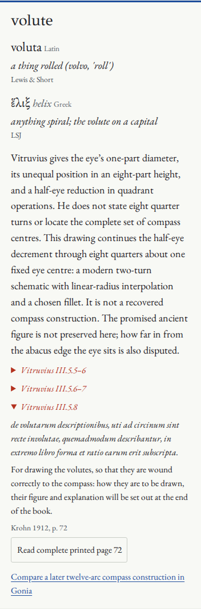

# Eight quarters are a model choice

Embater's early audit said that its actual groove now reached all eight
“prescribed” quarter-radius stations. That overstated what the text determines.
The numerical repair was real, but those eight stations belong to this model's
continuation. The wording is corrected in the live card, Orders explanation,
saved experiment notes, code comments and audit.

## Read the distinction

[Open the selected Ionic volute](https://antonsoo.github.io/embater/#order=ionic&view=detail&part=volute).
Read the card and its three passages; **Read complete printed page 72** opens
Vitruvius's promise of a figure and explanation. The brackets around supplied
words in the page-71 excerpt remain visible, and the complete apparatus can be
inspected.

| Item | Evidence or choice |
|---|---|
| Eye one part across in an eight-part height | Vitruvius III.5.5–6, Krohn p. 71 |
| Eye centre dividing 4½ above from 3½ below | Same passage |
| Half-eye reduction in quadrant operations | III.5.6, Krohn p. 71; the ending is textually difficult |
| Figure and explanation promised | III.5.8, Krohn p. 72 |
| Eight quarters, about one fixed eye centre | Embater's modern continuation |
| Continuous linear-radius curve and fillet | Modern drawing choices; not circular compass arcs |
| Twelve selected centres in Gonia | Its separate interpretation of Juglaris & Locke's 1889 English Vignola, plate XV |

In Embater's chosen continuation, measuring in eye diameters d gives
`r(q) / d = 4.5 - q/2`. Setting the last radius to the eye's radius, `d/2`, gives
`q = 8`. This arithmetic explains the schematic's two turns. It does not turn
those assumptions into a surviving ancient construction or locate a set of
moving compass centres.

Denise Andrey and Mirko Galli's research article,
[“Geometric Methods of the 1500s for Laying Out the Ionic Volute”](https://ftp.gwdg.de/pub/misc/EMIS/journals/NNJ/AndGal.html),
*Nexus Network Journal* 6.2 (2004), distinguishes clear proportions from the
incomplete layout instructions and discusses different later solutions. Their
account specifically separates the conditional eight-quarter calculation from
a number explicitly stated in the text. The promised ancient diagram is not
preserved. The retained primary pages remain the basis for reading the Latin;
this article supplies research context, not a replacement scan or an ancient
recipe.

## Continue in the existing compass workshop

The **Compare a later twelve-arc compass construction in Gonia** link opens
[the compass desk](https://antonsoo.github.io/gonia/volute.html). Its introductory
note identifies the much later guide; it does not claim to restore Vitruvius's
missing figure. Embater's selected eye also offers this handoff.

1. Open **Other starting sheets**, then **Draw the full printed sequence**.
2. Inspect **Arc 12 → eye circle**. The endpoint meets the eye, but the tangent
   directions differ. Contact alone does not establish a smooth join.
3. Choose an earlier join and **Align the next centre**. The local intervention
   aligns that pair of directions while moving the next endpoint. It is not a
   newly recovered historical method.
4. Inspect the later plate separately from Krohn's Latin and keep the actual
   compass measurements. The two workshops demonstrate different models with
   distinct evidence boundaries.

The handoff review operates these controls in both browsers and widths. Gonia's
repository and hosted runtime were not changed by this clarification.

Reproduce the operated handoff after a production build:

```sh
npm run test:scroll-handoff -- http://127.0.0.1:4493/embater/ /tmp/scroll-handoff
python3 scripts/scroll-handoff-artifacts.py /tmp/scroll-handoff
```

The browser driver uses Chromium and Firefox at 1440 and 375 pixels. It opens
and hashes Embater's complete printed page 72, follows the actual card link by
keyboard, operates the published later compass construction, hashes its separate
1889 plate, and downloads its native CSV. The independent CSV check follows the
actual twelve quarter circles, verifies their exact endpoint on the eye and
calculates the final direction difference from the exported vectors. The local
alignment demonstration does not alter those committed measurements.

Local receipts: [handoff](review/roof-audit/scroll-local.json),
[independent native CSV checks](review/roof-audit/scroll-native-artifacts.json),
[portable roof readings](review/roof-audit/scroll-readings-browser.json),
[independent reading artifact checks](review/roof-audit/scroll-readings-artifacts.json).
Adding the promised-figure passage brings the current rule count to 53; all
26 retained source images still reproduce byte for byte, and the font build
remains identical. The four compass CSVs are retained beside these receipts.
Their final direction difference independently calculates to 8.130102354156°.


