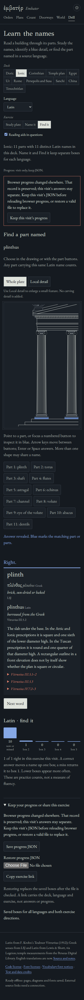

# One visit must not erase another

This follows the [vocabulary publication audit](vocabulary-audit.md). Application
source: `b018fe566e0fc30ce45025b4da0248da5f724d26`. The language practice, actual
drawings, retained sources and illustrated studies remain the existing lesson;
this change protects its browser progress.

## Reproduce the loss

At parent `a03683f`, open Doric / Latin / Find it and Ionic / Latin / Find it in
two tabs **before** answering either question. Answer the Doric shaft correctly,
then answer the Ionic plinth in the still-stale second visit. Its whole-record save
removes the Doric answer. Both records are valid; the old unread-record protection
does not help. The [captured baseline](progress-review/before.json) reproduces the
lost first answer in Chromium and Firefox, with no stale-visit warning.

## What now happens

Each automatic save captures that visit's boxes, takes a short exclusive lock,
and rereads the exact browser record. A changed record is preserved. The stale
visit continues operating and retains its own native JSON backup. The visits remain
independent; there is no automatic record merge. Keep that visit's
JSON before reloading the current browser record. An explicitly selected, valid
restore file may replace browser progress.

A storage event warns early, but the locked comparison decides whether a write
may proceed. Dropping the event therefore cannot bypass protection. A delayed
native event rereads current bytes, so an old notification cannot invalidate a
completed explicit restore. Pending snapshots from the same visit serialize;
a valid restore supersedes its older pending saves. A new answer during a queued
restore is retained too.

The visible caption distinguishes **saving**, **saved in this browser** and
**visit only; keep JSON**. Only the latest requested snapshot can report saved.
A lock acquisition has a two-second cancellation timer. When coordination is
unavailable or a storage write fails, the visit and its JSON remain available;
the application does not claim persistence. A later successful answer includes
all that visit's still-unsaved answers.



The implementation uses the browser's [Web Locks API](https://w3c.github.io/web-locks/)
with the existing progress key as the resource name. The critical section holds
no network request or asynchronous source reading. The [design notes](progress-concurrency-design.md)
explain the snapshot, restore and event ordering.

## Boundaries

- This coordinates **updated, cooperating visits** in the same browser/profile and origin. A previously
  loaded old version, developer tools, or other code ignoring the lock can still
  mutate storage. Refresh old tabs before relying on the coordination guarantee.
- Visits remain independent. This is protection against replacement, not automatic
  cross-tab score synchronization. An explicit restore deliberately replaces the
  browser record; keep the relevant native backups first.
- Browsers without the coordination API retain the visit and JSON backup, while
  reporting browser saving unavailable. Background suspension can delay browser
  timers; the pending state remains visible and the backup path stays operable.
- Progress schema/version, file names, language/direction keys and old mixed-language
  preservation remain unchanged. The boxes are practice counts, not fluency measures.

## Operated evidence

The [20-case browser receipt](progress-review/browser.json) covers ten scenarios
in each engine:

| Scenario | Observed result |
| --- | --- |
| Stale tab | Newer record intact; second visit's answer in real downloaded JSON |
| Storage event suppressed | Locked reread still prevents replacement |
| Two answers queued behind an actual held lock | One browser record survives; the other visit warns; both backups retain answers |
| Three queued answers in one visit | All answers survive in the final record |
| Restore supersedes a queued answer | Old snapshot cannot roll back the file; a new answer survives |
| Acquisition timer expires | No premature write; backup works; later answer saves the complete visit |
| Coordination API unavailable | Existing bytes intact; answers, backup and restore work for the visit |
| Delayed native storage event | Completed restore stays current; later answer persists |
| Answer during a stale visit's queued restore | Explicit replacement and the new answer both survive |
| Write throws after a successful read | Previous record intact; backup retains answer; later successful write includes the visit |

The simultaneous case checks that two real lock requests are pending before
releasing a third page's lock. The queued-restore cases similarly control ordering.
The records are controlled practice fixtures. Quota-error and unavailable-API
cases inject those failures; lock queues, backing records, native storage events
and downloaded files are operated in the actual browsers. The stale phone view fits 375 px; axe finds no violations in the
reviewed dark Chromium and light Firefox recovery states. This is not a complete
assistive-technology audit.

The [eight-configuration grading replay](progress-review/grading.json) still
operates all 19 language exercises and 124 study entries per configuration.
The [four source/file/offline journeys](progress-review/source-offline.json) pass,
including actual source/export deadlines and successful retries in both engines.
All four illustrated studies have the **same SHA-256 as the earlier publication**:
the progress fix changes neither their teaching material nor retained source/font bytes.

A clean install/check and an independent Node 24 test/build reproduce all
[89 production files](progress-review/build.json). `npm run check` passes its
existing 60 tests. The meaningful progress evidence is the actual record/backup
behavior above, not the test count.

```sh
node scripts/progress-tabs.mjs http://127.0.0.1:4492/embater/ /tmp/embater-progress-tabs
```

Run against a fixed production build. The original long-running local preview
expired during one attempted replay; that run failed at navigation before any
learner operation. Restarting the preview and rerunning supplied the successful
receipts here. It was not treated as an application pass.

Hosted source, deployed byte and hosted browser receipts are recorded separately
when publication completes.

## Published follow-up

Source `e3a057ee645e833f81b9dacba9d7f893f46b962a` is on `main`.
Reviewed application `b018fe5` was published by fast-forward update of `gh-pages`
to `d1b759637d539241e11b32df737fa397f061d833`, with `.nojekyll` retained.
All **89 canonical hosted files** match the clean build through both
[gzip after decompression](progress-review/public-bytes.json) and
[identity responses](progress-review/public-identity.json). All **46 immutable
raw source artifacts** match their git blobs, including the progress code,
verification driver, source pages, fonts, licenses and manifests.

The [hosted 20-case progress replay](progress-review/public-tabs.json) passes both
engines. The separate [hosted grading replay](progress-review/public-grading.json)
passes all eight configurations, and the [hosted source/file/offline replay](progress-review/public-source-offline.json)
passes all four configurations plus fault, elapsed-deadline, successful retry and
protected-record recovery cases. The actual hosted illustrated-study files again
match the earlier edition byte for byte. Canonical entries were rechecked after
the browser workflows.

The [workflow receipt](progress-review/public-ci.json) remains separate: source
CI `41290446306` and source Pages `41290446344` failed with zero executed steps.
They provide no test/build validation. Internal Pages deployment `41290534563`
succeeded for the reviewed Pages commit. Validation is the clean build and the
operated local/hosted byte, storage, download and offline evidence above.

```sh
python3 scripts/vocabulary-publication.py --include-progress --source e3a057ee645e833f81b9dacba9d7f893f46b962a --output /tmp/embater-progress-public.json
```

Add `--encoding identity` for an independent uncompressed-response comparison.
Documentation-only follow-up commits do not change the published application bytes.
