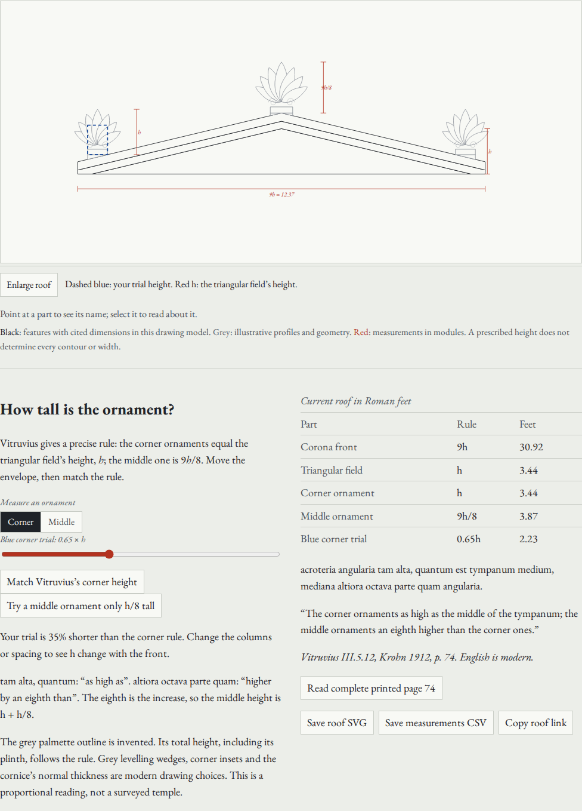

# How tall is the ornament?

The Orders workshop now lets a reader operate the height words in Vitruvius
III.5.12. A blue envelope can measure a corner or the middle ornament. Try a
middle ornament only h/8 tall, then match the reading: its height is h + h/8.

This revision is local and has not been pushed or deployed. The existing public
site is a separate edition.

## Try the actual work

After the README quickstart, open:

```text
http://127.0.0.1:4412/embater/#order=doric&columns=6&view=roof&trial=0.5
```

1. Move **Blue trial height** with the arrow keys. Change the number of columns
   and watch the triangular field and prescribed ornaments change together.
2. Choose **Middle**, or **Try a middle ornament only h/8 tall**. The short trial
   reads the eighth as the whole height. **Match Vitruvius's middle height** sets
   the envelope to 1.125h.
3. Select **acroterion** in the key for its Greek and Latin names. Read complete
   printed page 74; the page stays open while you adjust the measuring trial.
4. **Enlarge roof** makes the diagram scrollable. Focus moves to the drawing;
   arrow keys scroll it. **Fit roof** restores the fitted drawing.
5. Save the SVG and full-precision CSV. Open the SVG directly in a browser,
   without the app. **Copy roof link** retains the order, spacing, scale, view,
   trial, target ornament and selected part. If clipboard access is unavailable,
   the interface directs the reader to copy the current browser address.

Doric, Ionic and Corinthian use the existing order controls and share the
corrected roof builder. Tuscan retains its separate IV.7 roof model; it does not
acquire a III.5.12 roof-proportion control.



## Inspect the source

I inspected the complete retained printed pages 73 and 74 of F. Krohn's 1912
Teubner edition. Page 74 gives both the one-ninth tympanum rule and:

> acroteria angularia tam alta, quantum est tympanum medium, mediana altiora
> octava parte quam angularia.

A new literal English reading: the corner ornaments as high as the middle of the
tympanum; the middle ornaments an eighth higher than the corner ones.

The operated language distinction is between *tam alta, quantum* (equality)
and *altiora octava parte quam* (higher by an eighth). The eighth expresses the
difference, so the total is nine eighths. Greek and Latin part names retain the
existing dictionary notes; no new etymology or ancient pronunciation is asserted.

| Quantity | Proportion in this model |
|---|---|
| Horizontal corona front, including its outer cymatium edge | 9h |
| Tympanum at its middle | h |
| Corner ornament, including its drawn plinth | h |
| Middle ornament, including its drawn plinth | 9h/8 |

[Original scan, printed p. 74](https://archive.org/details/vitruviidearchit00vitr_1/page/n91/mode/1up).
The retained `public/sources/vocabulary/p74.jpg` is 622397 bytes with SHA-256
`e0d002b98c95e98774b8e4051e47b0de235a161aced5928c55e839cba6ca13bd`.
Each browser journey hashes the displayed image bytes against that value.
This verifies the retained artifact's identity; it is not a claim that the remote
archive was downloaded again during the review.

## What was wrong in the drawing

At the preceding local revision, `8fc4d7b5576391d81a54e7c32d22767e6d065f78`, `acroterion(0, 0, 1)` reached 1.012 units high.
The central petal's root plus its length exceeded the requested total, including
the plinth. The centre ornament also began half a sima thickness below the
roof's top; corner plinths used the eave elevation despite being inset uphill.
A 42-unit front reported its roof's highest tip at 28.321550504630984 while the
actual highest geometry was 28.098002822032587, with base 17 and projection 2/3.

The central petal now ends at the requested total height. The middle plinth
begins at the roof's highest point; corner plinths sit above the local slope.
Grey levelling wedges fill the space underneath. The reported highest tip
matches the actual vertices. These changes affect the existing whole fronts as
well as the new roof view.

Small illustrative cornice lips previously extended beyond the prescribed
projection. Their extents now stay within it, so h is a ninth of the actual
horizontal corona's outer span. A regression check reads the drawing pieces'
extremities rather than trusting the requested dimension.

The first independent SVG opening also exposed thick dimension bars: a stroke
width inherited from a group scaled with the SVG. Saved dimension lines now
explicitly use non-scaling strokes. The retained browser review opens native
downloads and checks that property; screenshots were inspected after the fix.

## Model boundaries

The source determines height ratios, not palmette outlines. Palmettes, included
plinths, corner insets, levelling wedges and normal rather than vertical cornice
thickness are modern drawing choices. The wedges are grouped with the sima and
painted grey; that grouping does not claim that Vitruvius describes a wedge.
The projection and fascia conventions elsewhere in the existing elevations
remain those of the workshop. This is neither a survey nor a reconstruction of
an individual Greek temple. Doric applies the pediment instructions through
IV.3.6; Ionic and Corinthian use the existing III.5 construction.

The table displays Roman feet to two decimals; the CSV retains unrounded
floating-point values. No conversion to modern metres is made. SVG coordinates
are rounded to three decimal places. Its English labels use a system serif;
no network fonts or remote resources are needed. The SVG includes the drawing,
source citation, model limitations and MIT attribution, but not source-page
pixels. The app's complete saved edition retains the source pages separately.

## Reproduce the review

```sh
npm ci
npm run check
npm run verify:roof-artifacts
```

For the operated-browser review, serve the production build in one terminal:

```sh
npm run preview -- --port 4493
```

In another:

```sh
npm run test:roof -- http://127.0.0.1:4493/embater/ /tmp/embater-roof-review
python3 scripts/roof-artifacts.py /tmp/embater-roof-review
```

The browser script needs the Playwright Chromium and Firefox browsers already
installed. It performs the work at 1440px and 375px, including keyboard controls,
three orders, the Tuscan boundary, the two Latin readings, source identity,
enlargement, saved SVG/CSV, reopening the shared state, light/dark screenshots,
and offline reload/source/download after the worker reports the complete edition
saved. It also checks runtime errors and serious/critical accessibility findings.

The Python check independently parses the exported SVG and CSV, measures the
three drawn ornaments, and checks h, 9h/8, 9h and the actual blue envelope within
SVG rounding tolerance. It does not import the TypeScript model. The checked
[SVG](../examples/roof/ionic.svg) and [CSV](../examples/roof/ionic.csv) are native
browser downloads from the four-column Ionic eustyle example, lower diameter
2.5 Roman feet, corner trial 0.65h.

Retained receipts: [browser matrix](review/roof/browser.json),
[independent artifact measurements](review/roof/artifacts.json).
The production build command is `npm run build`; output is `dist/`.
These are local source, build and browser results. No hosted-byte, remote-CI,
source-publication or deployment result is claimed.

Local `npm run check` passed with 64 tests. Biome returned success with 12
pre-existing warnings and three informational notes in other review scripts;
the changed TypeScript/CSS/browser-review files have no new diagnostics.

Suggested repository description: “Read Vitruvius through measured temple
drawings, Greek and Latin vocabulary, and retained source pages.”
Topics: `vitruvius`, `ancient-greek`, `latin`, `architecture`, `geometry`, `education`.
