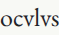
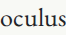

# Read the page before saving the book

Application source `81fbec4c4652ded518f109f8eac4b262af6e5ab4` follows the
[vocabulary/source audit](vocabulary-audit.md) and [progress-integrity review](progress-concurrency-review.md).
The reader now bounds background installation traffic, preserves an accurate
saving state, and keeps dictionary-style Latin glyphs in the portable study.

## A cold visit is a different journey

The warmed source and offline replays passed, but a final catalogue journey exposed
a cold Firefox source read that reached the application's 15-second deadline.
An earlier driver failure at five seconds had merely observed “Loading”; its
source-state wait was corrected to cover the actual deadline. The later run
reported the application's timeout, not just the driver's shorter wait.

[Six direct cold probes](source-loading-review/public-cold-before.json) subsequently
completed successfully. Their request traces show headers arriving well before
the full image body. These probes show the failure is not universal; they do not
prove the exact cause of each untraced public timeout.

A controlled native-browser experiment isolates a concrete contention problem.
Its local HTTP server serves the actual production bytes. JPEG bodies share one
4 KiB chunk every 8 ms, nominally 500 KiB/s; headers and other resources are
unthrottled. Registration is delayed only until the initial plate/fonts are ready,
then released before opening page 71. The server gives no preference to the
foreground request. This is a **synthetic network condition**, not an Internet
speed benchmark or a latency guarantee.

| Browser | Earlier batch installation | Bounded installation |
| --- | --- | --- |
| Chromium | Source loads within the deadline; healthy partial install is reported failed | Source loads; healthy partial install remains saving |
| Firefox | Foreground source reaches its deadline; six image streams observed | Source loads within the deadline; four image streams observed, including foreground |

The [before receipt](source-loading-review/priority-before.json) and
[after receipt](source-loading-review/priority-after.json) retain elapsed times,
active image-stream peaks, partial-install status, actual source hashes and
successful later offline reads. The controlled run used WSL2 Linux, 14 CPUs in the process affinity mask and
47.05 GiB of physical memory. Its timing values describe this run, not learner
performance. The early driver label said about 512 KiB/s; 4 KiB / 0.008 s is
500 KiB/s. That metadata label is corrected without changing measurements.

## The small implementation change

Installation now uses three concurrent `cache.add` operations instead of queuing
the whole edition through one `addAll`. The resource requests retain their build
integrities. A partial cache can exist during installation, but **the worker is
not activated until every request succeeds**. Readiness still requires the current
controlling worker and its complete byte audit. This is not a weaker offline promise.

The initial 12-second footer check now distinguishes a still-installing worker
from a failed installation. A healthy long save says it is still saving and that
the workshop remains usable. It does not instruct a needless reload or claim the
partial edition is ready.

Both engines also exercise a deliberately failed installation (503 on a different
retained page), continued foreground reading, a successful retry after the network
recovers, complete-edition readiness, and a verified source read after going offline.
The [older three-tab recovery suite](source-loading-review/recovery.json) still
passes: source/font/license corruption, false repair rejection, successful repair,
eviction, stale replies, cancellation and late-file preservation. Worker restart
is exercised in Chromium only.

## Correct text can still have the wrong teaching appearance

The downloaded HTML already contained `oculus`, but its Latin language tag enabled
EB Garamond's locale-specific `v` alternates. Its visible word was `ocvlvs`, while
the workshop deliberately keeps dictionary-style `u` forms. The portable CSS now
carries the same font feature/language override as the workshop. This changes
rendering, not the encoded Latin, translations, vocabulary or source images.

Before: 

After: 

The [before](source-loading-review/glyph-before.json) and
[after](source-loading-review/glyph-after.json) compare actual word screenshots
with the same word rendered under the font's English dictionary forms. The older
Latin rendering differs; the corrected one matches. The native file driver checks
this equality in all four browser/width cases with scripts disabled, then restores
the word's Latin language tag. Font cmap coverage alone would not detect this issue.

The retained [HTML](../examples/vocabulary/eye-study.html.gz) and
[PDF](../examples/vocabulary/eye-study.pdf) are refreshed actual downloads. Their
[artifact receipt](source-loading-review/artifact.json) verifies the nine font blobs,
CSS/cmap coverage, included license texts, source image and native CSV. Underlying
font bytes, source pages and vocabulary CSV fields remain unchanged. Earlier
published receipts remain evidence for their named editions; the new HTML bytes
include the deliberate typography correction.

## Reproduce and review

```sh
REQUIRE_SOURCE_READY=1 node scripts/source-priority.mjs dist /tmp/embater-source-priority
npm run test:vocabulary -- http://127.0.0.1:4492/embater/ /tmp/embater-native-reading
```

The first command serves its own local, throttled fixture origin; the second uses
a fixed production preview. `source-priority.mjs <older-dist> <output>` without the
requirement flag records the older behavior without assuming a pass.

The [final clean build](source-loading-review/build.json) reproduces all 89 files
under an independent Node 24 test/build. The [eight grading configurations](source-loading-review/grading.json),
[20 progress scenarios](source-loading-review/progress.json) and
[four source/native-file/offline journeys](source-loading-review/source-offline.json)
pass, including elapsed source/export deadlines and subsequent successful retries.
Axe and viewport checks apply to the reviewed states, not every conceivable browser.

Hosted source, response variants and final catalogue journeys are recorded
separately after publication.
