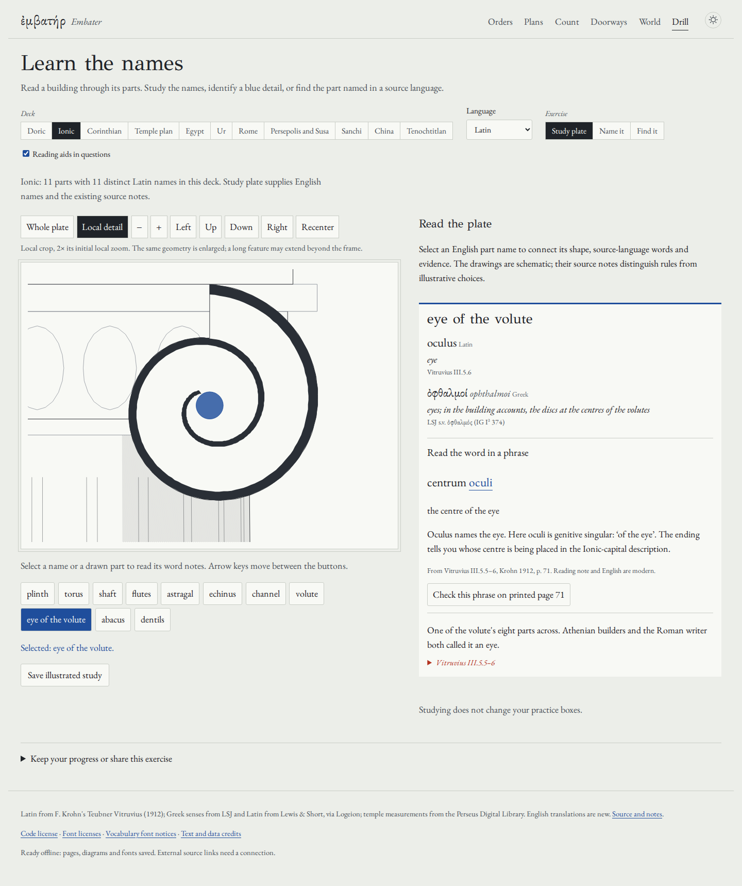

# Find a column's eye

This audit extends the language-specific drill reviewed at `024c1b0`.
The application source under review is
`5dac1e0` (building on the source-reader implementation `f67003c` and
the activation correction `e9a1444`).
The earlier [grading review](drill-review.md) remains evidence for its earlier
revision, not a substitute for the checks here.

## Try the actual work

[Open the selected Ionic eye](https://antonsoo.github.io/embater/drill.html#deck=ionic&lang=la&mode=study&part=oculus).
Choose **Local detail**, zoom with the plus button, pan, and recenter. The same
SVG coordinates remain in use; no carving or archaeological detail is added.
Select another word and the crop centres on a painted portion of that part.
Long features can extend beyond the frame. Whole plate is one action away.

Read *centrum oculi*, “the centre of the eye”. The stored name is *oculus*;
*oculi* here is genitive singular. Open the complete printed page 71, enlarge
it, focus the page frame and pan with arrow keys. Close returns focus to the
source button. Four short notes connect stored names to their printed forms:

| Stored name | Printed phrase | Reading |
| --- | --- | --- |
| oculus | centrum oculi | the centre of the eye |
| scapus | addita octava decuma parte scapi | with an eighteenth part of the shaft added |
| triglyphus | contra triglyphos | opposite the triglyphs |
| torus | superior torus | the upper torus |

These are modern grammar notes and new English explanations, not an independently
reviewed translation. The shaft phrase belongs to the Ionic-capital passage; it
does not prescribe the taper of every column. Original lemma links lead to
Logeion; the audit consulted the visible dictionary entries for these four nouns.

Save the illustrated study. Open the resulting HTML without a connection or
scripts. Its native CSV link retains this deck's selected-language vocabulary.
The file contains the selected word, both drawings, all its cited complete
pages, font bytes and licenses. It contains no practice scores. A canonical
reopen link restores the selected word, language and study mode; it does not
preserve the current pan or zoom.



## Failures found and corrected

- **Small geometry was technically selectable but hard to read.** The original
  whole-plate scan compared selected/plain screenshots of 89 distinct parts at
  two widths. All 178 pairs differed, but the Ionic eye changed only 46 pixels
  at 375 px. A DOM class alone would have missed this usability problem.
- **A bounding-box crop could be empty.** The first detail implementation missed
  seven selections: plan stylobate/pteroma, Egyptian open papyrus, Roman
  tholus/rotunda, Chinese zhu and Mexican teocalli. Centres fell in openings or
  behind other features. The SVG reader now looks for a painted point in drawing
  order, using native fill/stroke hit testing. All 89 phone detail pairs at 2x
  initial crop zoom show changed pixels (minimum 302). Pixel differences establish
  visibility, not historical accuracy or legibility at every possible pan.
- **The sticky word card blocked clicks.** Longer source material could overlap
  later part buttons. The card now remains in normal document flow. Pointer and
  keyboard journeys operate the part buttons after closing the source reader.
- **An unreadable saved record could be overwritten by the next answer.** Reading
  failure now protects that raw record from automatic writes. A visible banner
  leads to saving the current visit as JSON. An explicit valid restore lifts the
  protection; failed or invalid imports do not. Storage failure after a successful
  read is also reported visibly. Multiple simultaneous tabs are not synchronized.
- **Fast navigation could leave Firefox uncontrolled.** The larger packet exposed
  a transition from Orders to Drill during activation. The worker was activated
  and a cache existed, but the new document had no controller. The isolated
  baseline reproduces this on its first Firefox trial; the other five baseline
  trials pass. A matching ready worker now repeats its claim when the registered
  document remains uncontrolled. Its controllerchange still triggers a full byte
  audit before readiness. All six fresh after-fix trials pass. See
  [before](vocabulary-audit/navigation-before.json),
  [after](vocabulary-audit/navigation-after.json) and
  [uncontrolled state](vocabulary-audit/uncontrolled-firefox.json).
- **Five citations omitted the continuation page.** Complete retained pages make
  the span visible instead of dropping the end of an excerpt.

| Rule | Complete printed span |
| --- | --- |
| Doric triglyph | 83-84 |
| Doric history | 77-78 |
| Attic base | 69-70 |
| Ionic corona | 73-74 |
| Tuscan column | 90-91 |

The shared shaft, neck, cushion, abacus, plinth and torus notes now distinguish
Doric, Ionic and Tuscan prescriptions. The Doric cushion **with its rings**
occupies the middle third; the Tuscan cushion itself occupies that third.
A Tuscan plinth is round and a quarter-diameter high, unlike the square
sixth-diameter Attic/Ionic plinth. A rectangular front outline cannot decide its
plan shape. Ionic abacus width changes above 25 feet: III.5.7 on printed page 72
adds a ninth rather than an eighteenth. The existing geometry already uses that
height boundary; the shared vocabulary note had omitted it.

## Original evidence and resource cost

The original public-domain witness is F. Krohn, *Vitruvii De architectura libri
decem* (Teubner, 1912), Internet Archive item `vitruviidearchit00vitr_1`.
The downloaded PDF has 16,915,191 bytes and SHA-256
`b13a68789a8a1dc567b6f9b47eabe6a37a306329fbfc2c1a027a6c30a90d5139`.
Printed page p is PDF page p+18. The [manifest](../public/sources/vocabulary/manifest.json)
retains original URLs, exact page identities and rendering commands.

All 26 fresh JPEG renders reproduce byte for byte: 15,973,190 retained bytes,
covering the 51 cited rules, including the new tall-Ionic abacus excerpt. The
boundary-page contact sheet was inspected, alongside full-resolution pages 70,
71, 72 and 83. Source text extraction helped locate continuation boundaries;
its token-overlap heuristic is not a philological correctness test. This audit
does not claim a fresh line-by-line review of every inherited Latin excerpt or
all world-vocabulary etymologies. Existing manuscript/editor reading notes remain
visible beside the excerpts and the complete apparatus.

The additional images are a material download: the complete reviewed build is
23,894,652 bytes across 89 files. The service worker retains the complete edition
in the background; this is not merely the initial JavaScript transfer. Older
source packets remain at their existing paths for their earlier portable readings.

Five renamed, licensed Noto subsets supply previously missing Chinese, Devanagari,
Old Persian, Egyptological and mathematical characters. Their total is 38,888
bytes. Immutable originals, input/output hashes, retained code points and full
copyright/OFL notices are in the [font manifest](../public/fonts/vocabulary-manifest.json)
and [notices](../public/fonts/VOCABULARY-OFL.txt). Original reading-font bytes and
older license identities remain unchanged. See [third-party credits](../THIRD_PARTY_NOTICES.md).

## Operated behavior and independent file checks

The [browser receipt](vocabulary-audit/browser.json) records Chromium and Firefox
at 1440 and 375 px with light/dark themes. Each operates Orders source pages 83/84,
69/70 and 90/91, then the selected Ionic eye, detail zoom/pan, source fit/enlarge,
keyboard scrolling, close-focus restoration, and an actual illustrated download.
Each saved file opens from disk offline with JavaScript disabled, exposes a native
CSV download, and makes no automatic HTTP request. The controlled app reload also
opens the selected word, printed page and a new illustrated study offline.
Axe reports no violations on the reviewed drill/source state; this does not
establish accessibility of every other application state.

Both engines additionally substitute a false source response, reject the image
and export, retry successfully, cancel a pending export, switch words during a
late source response, and exercise protected progress with a subsequent valid
restore. These failure cases disable workers so a good cached copy cannot bypass
the injected response. The reader uses generation checks, aborts and a deadline;
verified source bytes become visible only after successful image decoding.

The independent [artifact inspector](../scripts/vocabulary-artifacts.py) reads the
actual downloaded file. It checks all nine font hashes, actual font cmaps against
CSS ranges, coverage of its visible text, retained page bytes, CSV fields and
included license texts. The [receipt](vocabulary-audit/artifact.json) describes the
kept eye study. The four-page Chromium PDF was rendered and visually inspected;
heading/page-break rules keep headings with their following text.

Keep the [PDF](../examples/vocabulary/eye-study.pdf), [CSV](../examples/vocabulary/ionic-latin.csv)
or decompress the [script-free HTML](../examples/vocabulary/eye-study.html.gz):

```sh
gzip -dc examples/vocabulary/eye-study.html.gz > /tmp/embater-eye.html
```

The [multi-tab recovery replay](vocabulary-audit/offline-recovery.json) also passes
in both engines: three tabs, missing/damaged source/font/license bytes, rejected
false repair, successful repair, eviction recovery, cancellation, stale source
and late-file preservation. Worker restart was exercised in Chromium only.

Four additional Chromium files exercise Egyptian, Old Persian, Sanskrit and
Chinese. The [font-use receipt](vocabulary-audit/script-fonts.json) records native
browser font inspection, confirming retained custom fonts render the selected
words. Each actual file opens offline without scripts; the independent
[artifact receipts](vocabulary-audit/script-artifacts.json) verify its glyph
coverage, embedded font hashes, licenses and CSV. World terms without an inherited
Vitruvius rule carry no invented source scan.

## Reproduce

```sh
npm ci
npm run check
npm run preview -- --port 4492
```

In another terminal:

```sh
npm run test:vocabulary -- http://127.0.0.1:4492/embater/ /tmp/embater-vocabulary
npm run test:drill -- http://127.0.0.1:4492/embater/ /tmp/embater-drill
node --import tsx scripts/vocabulary-visibility.mjs http://127.0.0.1:4492/embater/ /tmp/embater-pixels
node scripts/vocabulary-navigation.mjs http://127.0.0.1:4492/embater/ /tmp/embater-navigation
node scripts/vocabulary-script-fonts.mjs http://127.0.0.1:4492/embater/ /tmp/embater-scripts
python3 scripts/vocabulary-sources.py /path/to/identified-krohn-1912.pdf
```

Install Playwright's Chromium/Firefox before browser review. Font reproduction and
artifact inspection require the pinned Python packages in
`scripts/requirements-fonts.txt`. Supply the original font files identified by
the font manifest to `scripts/vocabulary-fonts.py --help`; check mode compares
outputs without changing them. Source reproduction requires Poppler's `pdftoppm`.
Keep the production build fixed while browser journeys run: replacing its assets
mid-install tests a moving deployment rather than one reviewed edition.

The final [grading replay](vocabulary-audit/grading.json) operates all 19
language exercises and 124 study entries in each of eight Chromium/Firefox,
1440/375 px, light/dark configurations. It also checks blocked storage, damaged
progress, preserved legacy data and the two papyrus answers. These counts describe
operated entries, not a new independent historical-vocabulary validation.

The [clean-build receipt](vocabulary-audit/build.json) compares every retained
production byte with an independently installed archive of the source commit.
Source builds, local browser operation, remote source, deployed bytes and hosted
browser operation remain separate claims. Publication receipts follow below.

## Published edition

Source `e332fea2443e1156d517e3613ff760ff9681d176` was pushed to `main`.
The reviewed build from application source `5dac1e0` was published by ordinary
fast-forward update of `gh-pages` to
`d7e8c737968f1c709eefc3d0ac6f50c8e9c5f588`. The separate Pages deployment
completed successfully. No credentials, Pages settings or billing settings changed.

Every one of the **89 canonical hosted files** matches the independently rebuilt
local bytes, and **42 immutable raw source artifacts** match their git blobs,
including all 26 retained JPEGs, five supplementary font subsets, their manifests,
licenses, the source reader's identities, word contexts and offline claim code.
Both [gzip responses after decompression](vocabulary-audit/public-bytes.json)
and [uncompressed responses](vocabulary-audit/public-identity.json) match.

There was a real propagation interval: the identity variant continued returning
older HTML/notices and 404s for newly published paths while gzip and the browsers
already received the new edition. The [stale receipt](vocabulary-audit/public-identity-stale.json)
retains that failed check. Probing gzip alone would not have established agreement
of both variants. A later complete identity replay matches every file. These are
observations of the canonical URLs, not cache-busted alternate pages.

The [hosted source/download replay](vocabulary-audit/public-browser.json) passes
all four Chromium/Firefox desktop/phone configurations, including actual source
bytes, native file/CSV downloads, script-disabled offline reading, worker-controlled
offline reload, substituted-source rejection and protected progress. The actual
saved studies match the local replay's SHA-256 in all four configurations.
The separate [hosted grading replay](vocabulary-audit/public-grading.json) passes
all eight theme/width/browser configurations, with 19 language exercises and 124
study entries in each, plus blocked/damaged/legacy storage cases.

The [workflow receipt](vocabulary-audit/public-ci.json) keeps CI separate:
source **CI** run `41287378208` and source **Pages** run `41287378188` failed with
**zero executed steps**. Those runs provide no build or test validation. The
internal Pages deployment run `41287466377` succeeded for the manually reviewed
Pages commit. Clean local checks and the hosted browser/byte evidence above are
the validation for this publication.

`scripts/vocabulary-publication.py --source <immutable commit> --output <receipt>`
replays the canonical hosted/source comparison. Use `--encoding identity` to
inspect the uncompressed variant independently. Documentation-only receipts do
not alter the reviewed application build.
